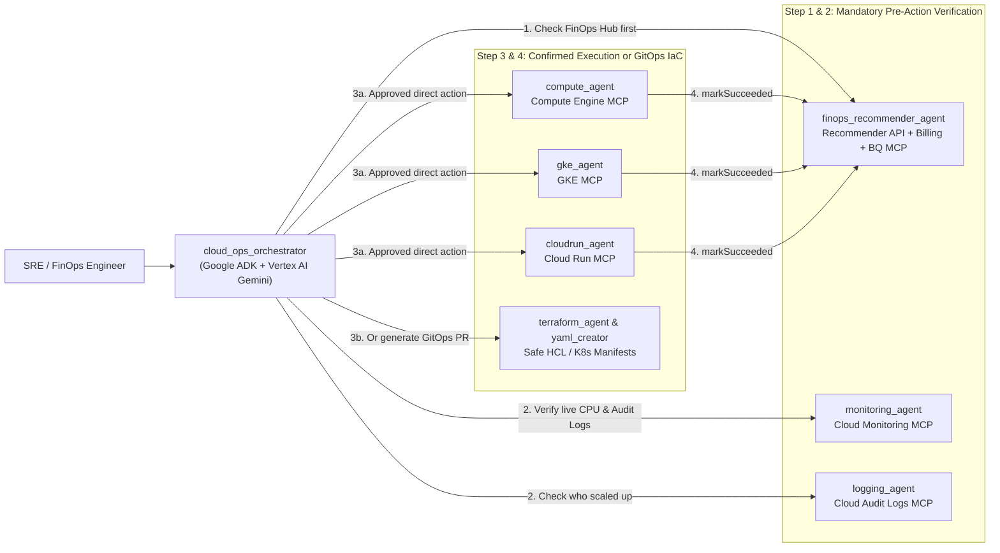

# Google Cloud FinOps + CloudOps ADK Agent

A multi-agent **Google Agent Development Kit (ADK)** orchestrator that connects directly to **Google Cloud FinOps Hub (`recommender.googleapis.com`)**, **Cloud Billing**, **BigQuery**, **Cloud Monitoring**, **Cloud Audit Logs**, **Compute Engine**, **GKE**, and **Cloud Run** via official Google Cloud Remote MCP servers and REST APIs.

Built around a strict **"Check Recommender & Telemetry First Before Acting"** guardrail so the agent summarizes FinOps Hub optimization findings, correlates forgotten peak-event scale-ups, confirms with a human, and syncs realized savings back to FinOps Hub (`ACTIVE` → `CLAIMED` → `SUCCEEDED`).

---

## Architecture & Pre-Action Guardrail



### How "Check Before You Act" Works
1. **Check FinOps Hub (`recommender.googleapis.com`) First:** Before proposing or executing any resize, stop, delete, or scale-down action, the orchestrator calls `finops_recommender_agent` to inspect active FinOps Hub cost recommenders (Compute VM/MIG, Idle VMs/Disks/IPs/Reservations, GKE `DiagnosisRecommender`, Cloud SQL, Cloud Run, and CUDs).
2. **Correlate Live Telemetry & Audit Logs:** Active Assist Recommenders typically observe 8–14 days of history to prevent false positives. The orchestrator also checks **Cloud Monitoring** (live CPU/memory drops) and **Cloud Audit Logs** (who scaled up a resource and when) so forgotten peak-event resources (e.g., after a flash sale or load test) are caught within hours.
3. **Human Confirmation Gate (`readonly` vs `readwrite`):** Summarizes potential monthly savings, live utilization, and the exact proposed change before mutating anything. Supports safe **Terraform HCL / Kubernetes YAML** output when infrastructure is GitOps-managed.
4. **Closed-Loop FinOps Hub Sync:** When approved in `readwrite` mode, the agent calls `mark_recommendation_claimed`, performs the change, and calls `mark_recommendation_succeeded` so FinOps Hub updates realized savings.

---

## Simplified Customer Deployment (1 Command)

### Prerequisites
- [Google Cloud CLI (`gcloud`)](https://cloud.google.com/sdk/docs/install) authenticated (`gcloud auth login`)
- A Google Cloud Project with Billing enabled
- Permissions to enable APIs, create a Service Account, grant IAM roles, and deploy Cloud Run

### Option A: 1-Command Deploy to Cloud Run (Recommended)

Deploy in **safe read-only evaluation mode** first (summarizes FinOps Hub findings, correlates metrics/logs, and generates Terraform/YAML without mutating resources):

```bash
git clone https://github.com/eazyCee/cloudops-agents.git
cd cloudops-agents
chmod +x deploy.sh

# Preview every gcloud command first (optional)
./deploy.sh --project YOUR_PROJECT_ID --dry-run

# Deploy to Cloud Run (defaults to safe --mode readonly and private ingress)
./deploy.sh --project YOUR_PROJECT_ID --region us-central1
```

Then open the ADK Web UI securely via the Cloud Run proxy:

```bash
gcloud run services proxy cloudops \
  --project=YOUR_PROJECT_ID --region=us-central1 --port=8080
# Open http://localhost:8080 in your browser
```

#### Common Deployment Options
| Goal | Command |
| :--- | :--- |
| **Enable automated remediation** (`readwrite` mode) | `./deploy.sh --project YOUR_PROJECT_ID --mode readwrite` |
| **Include Billing Account CUD recommendations** | `./deploy.sh --project YOUR_PROJECT_ID --billing-account 01ABCD-234567-89EFGH` |
| **Protect Web UI with Google IAP (corporate SSO)** | `./deploy.sh --project YOUR_PROJECT_ID --iap` |
| **Choose a different Vertex AI Gemini model** | `./deploy.sh --project YOUR_PROJECT_ID --model gemini-3-flash-preview` |
| **Clean up / delete Cloud Run service** | `./deploy.sh teardown --project YOUR_PROJECT_ID` |

---

### Option B: 2-Minute Local Run (Laptop / Cloud Shell)

```bash
./deploy.sh local --project YOUR_PROJECT_ID
# Opens ADK Web UI at http://127.0.0.1:8000
```

---

## Connected Google Cloud APIs & Managed Remote MCP Servers

All Google Cloud Remote MCP servers become available automatically when `./deploy.sh` runs `gcloud services enable`. OAuth tokens are refreshed automatically on every MCP session via ADK's `header_provider` (no 60-minute token expiry failures).

| Agent | Google Cloud Service | Remote MCP Endpoint / REST API | Purpose |
| :--- | :--- | :--- | :--- |
| `finops_recommender_agent` | Recommender API (FinOps Hub) | `https://recommender.googleapis.com/mcp` + `recommender.googleapis.com/v1` | List all 16 FinOps Hub cost recommenders + `markClaimed` / `markSucceeded` |
| `finops_recommender_agent` | Cloud Billing & Pricing API | `https://cloudbilling.googleapis.com/mcp` | Billing accounts, linked projects, negotiated SKU prices |
| `finops_recommender_agent` | BigQuery API | `https://bigquery.googleapis.com/mcp` | SQL over Detailed/FOCUS Billing exports & Org `recommendations_export` |
| `monitoring_agent` | Cloud Monitoring API | `https://monitoring.googleapis.com/mcp` | Real-time CPU/RAM/PromQL metrics & alerts |
| `logging_agent` | Cloud Logging & Audit Logs | `https://logging.googleapis.com/mcp` | Admin Activity audit logs (who scaled up resources & when) |
| `compute_agent` | Compute Engine API | `https://compute.googleapis.com/mcp` | Inspect & remediate VMs, MIGs, disks |
| `gke_agent` | Kubernetes Engine API | `https://container.googleapis.com/mcp` | Inspect clusters, node pools, Kubernetes workloads |
| `cloudrun_agent` | Cloud Run Admin API | `https://run.googleapis.com/mcp` | Inspect & update Cloud Run services |

> **Tip:** If your project does not use certain services (e.g., GKE or BigQuery), set `DISABLED_MCP_SERVERS=gke,bigquery` in `.env` or Cloud Run env vars.

---

## IAM Permissions Provisioned by `deploy.sh`

`deploy.sh` creates a dedicated Service Account (`cloudops-finops-agent-sa@<PROJECT_ID>.iam.gserviceaccount.com`) with least-privilege roles:

- **Read-Only Mode (`--mode readonly`, default):**
  `roles/aiplatform.user`, `roles/recommender.viewer`, `roles/monitoring.viewer`, `roles/logging.viewer`, `roles/compute.viewer`, `roles/container.viewer`, `roles/run.viewer`, `roles/bigquery.dataViewer`, `roles/bigquery.jobUser`
- **Read-Write Mode (`--mode readwrite`, adds):**
  `roles/recommender.computeAdmin`, `roles/recommender.cloudsqlAdmin`, `roles/recommender.runAdmin`, `roles/compute.instanceAdmin.v1`, `roles/container.developer`, `roles/run.developer`
- **Optional Billing Account Scope (`--billing-account <ID>`):**
  `roles/billing.viewer`, `roles/recommender.billingAccountCudViewer`

---

## Example Prompts to Try

1. **FinOps Hub Executive Summary:**
   > *"Check all FinOps Hub recommendations in `us-central1-a` and summarize our biggest monthly cost savings opportunities."*
2. **Pre-Action Safety Check Before Downscaling a Peak Resource:**
   > *"I think we left our checkout VM scaled up after last week's promo event. Check FinOps Hub recommendations, recent CPU utilization in Cloud Monitoring, and Audit Logs before suggesting how to scale it down."*
3. **GitOps / Terraform Remediation (Zero State Drift):**
   > *"Check our active recommendations in `us-central1` and generate a Terraform diff for any overprovisioned Compute Engine or Cloud Run resources."*
4. **Closed-Loop Action (`readwrite` mode):**
   > *"Check if there are any idle VMs in `us-central1-a`. Show me the FinOps Hub recommendation first, and once I confirm, stop the VM and mark the recommendation succeeded."*

---

## Project Structure

```text
cloudops-agents/
├── app/
│   ├── __init__.py          # Exports root_agent for ADK Web / API server
│   ├── agent.py             # Multi-agent orchestrator + mandatory pre-action guardrail
│   ├── finops_tools.py      # 16-recommender FinOps Hub scanner + markClaimed/markSucceeded
│   ├── tools.py             # Auto-refreshing GCP OAuth MCPToolset loader
│   └── mcp_config.json      # Enabled Google Cloud Remote MCP endpoints + tool filters
├── fail-demo/               # Optional demo Cloud Run service for debugging walkthroughs
├── Dockerfile               # Single-stage Cloud Run container serving ADK Web UI + API
├── deploy.sh                # 1-command customer deployment (Cloud Run, local, teardown)
├── requirements.txt         # Python dependencies (google-adk, mcp, google-auth, requests, aiohttp)
├── .env.example             # Configuration template for local runs
└── README.md                # This guide
```

---

## Troubleshooting

- **403 Permission Denied right after `./deploy.sh`:** IAM propagation in GCP can take 1–2 minutes. Wait 60 seconds and retry your prompt.
- **0 FinOps Hub recommendations returned:** Active Assist Recommenders require 8–14 days of utilization history before emitting cost recommendations. Ask the agent to correlate live **Cloud Monitoring** CPU/memory metrics and **Cloud Audit Logs** to detect recent peak-event scale-ups immediately.
- **Billing / CUD recommendations permission error:** Project-level IAM cannot view Billing Account-level CUDs. Re-run `./deploy.sh --project YOUR_PROJECT_ID --billing-account YOUR_BILLING_ACCOUNT_ID` as a Billing Account Admin (or grant `roles/billing.viewer` and `roles/recommender.billingAccountCudViewer` to `cloudops-finops-agent-sa@YOUR_PROJECT_ID.iam.gserviceaccount.com` on the Billing Account).
- **Disable unused MCP servers:** If your project does not use GKE or BigQuery, set `DISABLED_MCP_SERVERS=gke,bigquery` via Cloud Run environment variables or `.env`.

